# Arquitectura inicial del sistema

## Diagrama de arquitectura

```mermaid
flowchart TD

    subgraph ACTORES["ACTORES"]
        Paciente["Paciente"]
        Personal["Médico / Enfermería"]
        Admision["Personal de admisión"]
        AdminSis["Administrador del sistema"]
    end

    subgraph PRESENTACION["PRESENTACIÓN"]
        Portal["Portal web"]
        App["App móvil"]
        Estaciones["Estaciones clínicas y Triaje"]
    end

    subgraph ENTRADA["ENTRADA"]
        LB["Balanceador de carga activo-activo"]
        GW["API Gateway / Autenticación SSO"]
    end

    subgraph NEGOCIO["LÓGICA DE NEGOCIO - SERVICIOS"]
        Citas["Citas y Admisión"]
        HCE["Historia Clínica Electrónica"]
        Triaje["Triaje / Emergencia"]
        Soporte["Soporte: notificaciones y reportes"]
    end

    subgraph MENSAJERIA["MENSAJERÍA"]
        Bus["Bus de eventos asíncrono"]
    end

    subgraph DATOS["DATOS"]
        BD["Base de datos de HCE con réplica síncrona"]
        Cache["Caché en memoria"]
        DW["Data Warehouse / BI"]
        PACS["Almacenamiento de imágenes médicas"]
    end

    subgraph EXTERNOS["SISTEMAS EXTERNOS"]
        HIS["HIS MINSA"]
        SUSALUD["SUSALUD"]
        SIS["SIS / Aseguradoras"]
        Lab["Laboratorio referencial regional"]
        Notif["Plataforma SMS / Correo"]
    end

    ACTORES --> PRESENTACION
    PRESENTACION --> LB
    LB --> GW
    GW --> NEGOCIO
    NEGOCIO --> Bus
    NEGOCIO --> DATOS
    Bus -->|"integraciones"| EXTERNOS
    Citas -->|"valida cobertura"| SIS

    style ACTORES fill:#222,stroke:#fff,stroke-width:2px,color:#fff
    style PRESENTACION fill:#222,stroke:#fff,stroke-width:2px,color:#fff
    style ENTRADA fill:#222,stroke:#fff,stroke-width:2px,color:#fff
    style NEGOCIO fill:#222,stroke:#fff,stroke-width:2px,color:#fff
    style MENSAJERIA fill:#222,stroke:#fff,stroke-width:2px,color:#fff
    style DATOS fill:#222,stroke:#fff,stroke-width:2px,color:#fff
    style EXTERNOS fill:#222,stroke:#fff,stroke-width:2px,color:#fff
```

## Descripción

La arquitectura inicial se organiza en las siguientes capas:

- **Presentación:** permite la interacción de pacientes, personal clínico y de admisión mediante el portal web, la app móvil y las estaciones clínicas (incluido el módulo de Triaje).
- **Entrada:** un balanceador de carga activo-activo y un API Gateway con autenticación centralizada (SSO) son el único punto de acceso a los servicios.
- **Lógica de negocio:** servicios desacoplados por dominio: Citas y Admisión, Historia Clínica Electrónica, Triaje/Emergencia (destacado por su criticidad) y Servicios de Soporte (notificaciones y reportes).
- **Mensajería:** un bus de eventos asíncrono desacopla los procesos que no requieren respuesta inmediata (laboratorio, farmacia, notificaciones).
- **Datos:** base de datos de HCE con réplica síncrona, caché en memoria para sesiones y disponibilidad de citas, data warehouse para reportes y almacenamiento de imágenes médicas.
- **Sistemas externos:** HIS MINSA, SUSALUD, SIS/aseguradoras, laboratorio referencial regional y plataforma de notificaciones.
