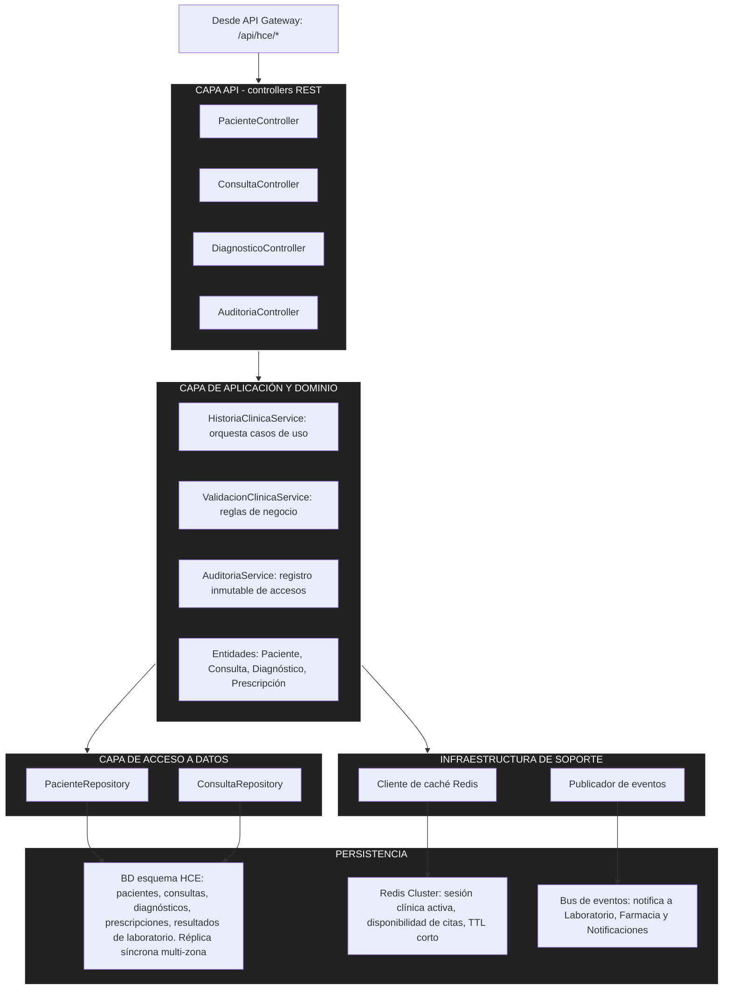

# Enfoque arquitectónico

Dentro de cada microservicio se aplica un enfoque **por capas**, con separación de responsabilidades. Como ejemplo, se muestra el microservicio de **Historia Clínica Electrónica (HCE)**, por ser el de mayor criticidad (ADR-008).

## Reglas del enfoque

1. Cada capa solo invoca a la capa inmediatamente inferior.
2. Los controladores REST no contienen reglas de negocio.
3. Las reglas de validación clínica viven en la capa de dominio, por lo que se pueden añadir sin modificar los controladores.
4. El motor de caché o el bus de mensajería pueden sustituirse sin afectar la capa de dominio.
5. Los mecanismos de resiliencia (reintentos, timeouts, circuit breakers) se aplican a nivel de código en esta estructura.
