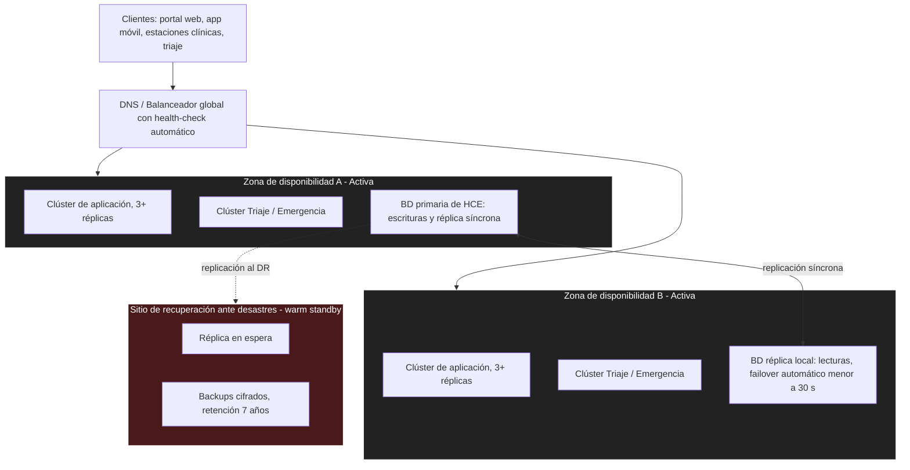

# Estilo arquitectónico

El sistema adopta un estilo de **microservicios desplegados en múltiples zonas de disponibilidad activas**, con un sitio adicional de recuperación ante desastres (DR). Responde a ADR-001, ADR-002, ADR-003 y ADR-004.

## Metas de recuperación

| Escenario | RTO | RPO |
| --- | --- | --- |
| Falla de una zona | < 5 minutos | ≈ 0 |
| Pérdida de ambas zonas (sitio DR) | < 2 horas | < 15 minutos |

## Justificación

- **Microservicios:** permiten escalar y proteger de forma independiente al módulo más crítico (Triaje/HCE) sin sobredimensionar los demás.
- **Multi-zona activo-activo:** la pérdida de una zona completa no interrumpe el servicio.
- **Sitio DR:** cubre el escenario de baja probabilidad pero alto impacto de falla simultánea de ambas zonas.
- **Portabilidad:** el uso de contenedores/Kubernetes reduce la dependencia de un único proveedor de infraestructura.
