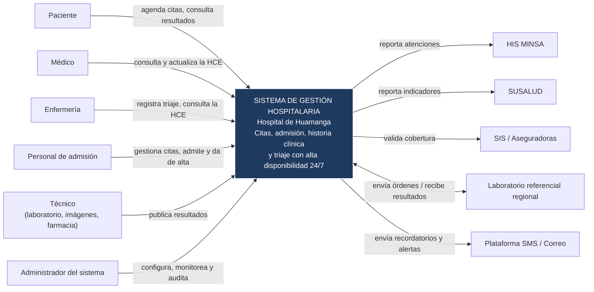

# Nivel 1 · Diagrama de contexto del sistema

> **Proyecto:** Sistema de Gestión Hospitalaria · Hospital de Huamanga  
> **Modelo:** C4 · Nivel 1 de 4

---

## 1. Objetivo

Mostrar el **sistema como una sola caja**: quiénes lo usan y con qué sistemas externos se comunica. Es la vista de mayor nivel y la primera que se presenta a cualquier persona, técnica o no.

| Aspecto | Descripción |
|---|---|
| Pregunta que responde | ¿Qué es el sistema, quién lo usa y con quién se integra? |
| Audiencia | Dirección Médica, áreas usuarias, docentes, equipo de desarrollo y TI |
| Qué **no** muestra | Tecnologías, servidores, bases de datos ni servicios internos |
| Siguiente nivel | [`Nivel2-DiagramadeContenedores.md`](Nivel2-DiagramadeContenedores.md) |

---

## 2. Diagrama

---

## 3. Personas (usuarios)

| Persona | Descripción | Qué hace en el sistema |
|---|---|---|
| **Paciente** | Persona atendida en el hospital, con cuenta en el portal o la app | Agenda, consulta, reprograma y cancela citas; consulta resultados; recibe recordatorios |
| **Médico** | Profesional que atiende en consulta, hospitalización o emergencia | Consulta y actualiza la HCE; registra consultas, diagnósticos y prescripciones |
| **Enfermería** | Personal en turnos de 12 h | Registra el triaje y consulta la HCE durante la atención |
| **Personal de admisión** | Atiende en ventanilla | Gestiona citas, hace el check-in, admite y da de alta, verifica cobertura |
| **Técnico** | Laboratorio, imágenes y farmacia | Registra y publica resultados de laboratorio e imágenes |
| **Administrador del sistema** | Responsable de la operación del sistema | Gestiona usuarios y roles, monitorea, audita accesos y consulta reportes |

---

## 4. Sistemas

| Sistema | Tipo | Responsabilidad | Quién lo construye |
|---|---|---|---|
| **Sistema de Gestión Hospitalaria** | Sistema en alcance | Gestiona citas, admisión, historia clínica electrónica y triaje | El equipo del proyecto |
| **HIS MINSA** | Sistema externo | Sistema Nacional de Información en Salud; recibe el reporte de atenciones | MINSA |
| **SUSALUD** | Sistema externo | Fiscalización sanitaria; recibe indicadores y reportes | SUSALUD |
| **SIS / Aseguradoras** | Sistema externo | Verificación de la cobertura del paciente | SIS y aseguradoras |
| **Laboratorio referencial regional** | Sistema externo | Recibe órdenes y devuelve resultados de laboratorio | Laboratorio regional de Ayacucho |
| **Plataforma SMS / Correo** | Sistema externo | Entrega recordatorios y alertas | Proveedor de mensajería |

---

## 5. Relaciones

| Origen | Destino | Descripción | Protocolo |
|---|---|---|---|
| Paciente | Sistema | Agenda citas y consulta resultados | — |
| Médico, Enfermería | Sistema | Consultan la HCE y registran consultas y triaje | — |
| Personal de admisión | Sistema | Gestiona citas, admisión y alta | — |
| Técnico | Sistema | Registra resultados | — |
| Administrador | Sistema | Configura, monitorea y audita | — |
| Sistema | HIS MINSA | Reporta atenciones | HTTPS (por confirmar) |
| Sistema | SUSALUD | Reporta indicadores | HTTPS (por confirmar) |
| Sistema | SIS / Aseguradoras | Valida cobertura | HTTPS (por confirmar) |
| Sistema ⇄ Laboratorio | | Envía órdenes y recibe resultados | HTTPS con HL7/FHIR (por confirmar) |
| Sistema | Plataforma SMS / Correo | Envía recordatorios y alertas | HTTPS/REST (por confirmar) |

---

## 6. Decisiones y supuestos

| # | Decisión o supuesto | Motivo |
|---|---|---|
| 1 | La integración con terceros sigue estándares abiertos (HL7/FHIR) | ADR-010 y RC02 |
| 2 | Los sistemas externos no se modifican; el sistema se adapta a ellos (patrón Adapter) | Son de terceros |
| 3 | Los datos de salud se tratan como datos sensibles | Ley N.° 29733 (RC01) |
| 4 | Un fallo de un sistema externo no debe impedir registrar la atención | Disponibilidad de los módulos críticos (DA01) |

### Pendientes por definir

| Tema | Detalle |
|---|---|
| Protocolo real de cada integración | La propuesta fija HL7/FHIR como estándar, pero cada entidad (HIS MINSA, SUSALUD, SIS) debe confirmar qué interfaz ofrece |
| Sentido de la integración | Confirmar qué datos se envían y cuáles se reciben de cada sistema |
| Proveedor de SMS / correo | No está definido; no cambia el nivel 1, pero sí el adaptador |
