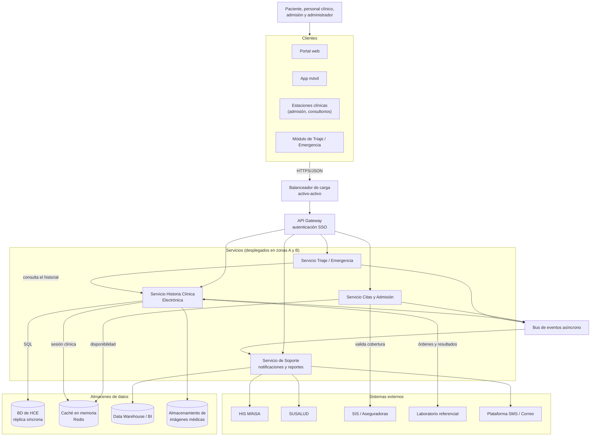

# Nivel 2 · Diagrama de contenedores

> **Proyecto:** Sistema de Gestión Hospitalaria · Hospital de Huamanga  
> **Modelo:** C4 · Nivel 2 de 4

---

## 1. Objetivo

Abrir la caja del nivel 1 y mostrar los **contenedores**: aplicaciones, servicios y almacenes de datos que se ejecutan por separado, su función y cómo se comunican.

| Aspecto | Descripción |
|---|---|
| Pregunta que responde | ¿De qué piezas ejecutables se compone el sistema? |
| Audiencia | Arquitectos, desarrolladores, operaciones |
| Qué es un contenedor | Algo que se ejecuta o almacena datos de forma independiente (no es lo mismo que un contenedor Docker) |
| Nivel anterior | [`Nivel1-DiagramadeContexto.md`](Nivel1-DiagramadeContexto.md) |
| Siguiente nivel | [`Nivel3-DiagramadeComponentes.md`](Nivel3-DiagramadeComponentes.md) |

---

## 2. Diagrama

> Los servicios de Citas, Triaje y Soporte también tienen su propio esquema de datos; el diagrama resalta la BD de HCE por ser la de mayor criticidad. Falta confirmar el motor y el esquema de cada servicio (ver pendientes).

---

## 3. Contenedores

| Contenedor | Tecnología | Responsabilidad | Datos que maneja |
|---|---|---|---|
| **Portal web** | Por definir | Agendamiento y consulta de resultados para pacientes | Solo estado de la pantalla |
| **App móvil** | Por definir | Mismas funciones que el portal desde el celular | Solo estado de la aplicación |
| **Estaciones clínicas** | Por definir | Interfaz de admisión y consultorios para el personal | Solo estado de la pantalla |
| **Módulo de Triaje / Emergencia** | Por definir | Interfaz de registro de triaje con acceso inmediato al historial | Solo estado de la pantalla |
| **Balanceador de carga** | Activo-activo | Reparte el tráfico entre zonas con health-check automático | Ninguno |
| **API Gateway** | Por definir | Único punto de entrada; autenticación SSO y enrutamiento | Ninguno persistente |
| **Servicio Citas y Admisión** | Microservicio | Disponibilidad, reserva, confirmación, reprogramación, check-in, admisión y alta, verificación de cobertura | Citas y admisiones |
| **Servicio HCE** | Microservicio | Historia clínica, consultas, diagnósticos, prescripciones y auditoría de accesos | Esquema HCE |
| **Servicio Triaje / Emergencia** | Microservicio | Registro y priorización del triaje; escalado prioritario | Registros de triaje |
| **Servicio de Soporte** | Microservicio | Notificaciones y reportes | Notificaciones e indicadores |
| **Bus de eventos** | Kafka o RabbitMQ (por definir) | Comunicación asíncrona entre servicios (laboratorio, farmacia, notificaciones) | Eventos en tránsito |
| **BD de HCE** | Por definir (relacional, transaccional) | Almacena la información clínica con réplica síncrona entre zonas | Pacientes, consultas, diagnósticos, prescripciones, resultados |
| **Caché** | Redis Cluster | Guarda sesión clínica activa y disponibilidad de citas con TTL corto | Copia temporal |
| **Data Warehouse / BI** | Por definir | Reportes e indicadores | Datos consolidados |
| **Almacenamiento de imágenes** | Por definir (PACS) | Guarda imágenes médicas | Imágenes |

---

## 4. Relaciones

| Origen | Destino | Descripción | Protocolo |
|---|---|---|---|
| Usuarios | Clientes | Usan el portal, la app o las estaciones | HTTPS |
| Clientes | Balanceador → API Gateway | Llaman a la API | HTTPS/JSON |
| API Gateway | Servicios | Enruta las peticiones autenticadas | HTTPS/JSON |
| Servicios | Bus de eventos | Publican y consumen eventos | Protocolo del bus |
| Servicio HCE | BD de HCE | Lee y escribe | SQL sobre TCP |
| Servicios Citas y HCE | Caché | Lee y escribe datos temporales | TCP |
| Servicio Triaje | Servicio HCE | Consulta el historial del paciente | HTTPS/JSON (API de HCE) |
| Servicio Citas | SIS / Aseguradoras | Valida cobertura | HTTPS |
| Servicio HCE | Laboratorio referencial | Envía órdenes y recibe resultados | HTTPS (HL7/FHIR) |
| Servicio Soporte | HIS MINSA, SUSALUD, SMS/Correo | Reportes y notificaciones | HTTPS |

---

## 5. Decisiones arquitectónicas reflejadas

| Decisión | Alternativa descartada | Motivo | ADR |
|---|---|---|---|
| Microservicios por dominio | Monolito | Escalar y proteger el módulo crítico sin sobredimensionar los demás | ADR-001 |
| Zonas A y B activas + sitio DR | Una sola zona | Alcanzar 99.99 % y cubrir la pérdida de un centro de datos | ADR-002 |
| Replicación síncrona de la BD de HCE | Replicación asíncrona | RPO ≈ 0 | ADR-003 |
| Autoescalado con colas por criticidad | Capacidad fija | Absorber picos de ~14,000 concurrentes y priorizar triaje | ADR-004 |
| API síncrona + bus asíncrono | Todo síncrono | Desacoplar laboratorio, farmacia y notificaciones | ADR-005 |
| Redis como caché | Consultar siempre la BD | Bajar la latencia en los puntos de mayor volumen | ADR-006 |
| API Gateway con SSO y balanceador activo-activo | Acceso directo a los servicios | Punto de entrada único y seguro | ADR-007 |

---

## 6. Seguridad entre contenedores

| Comunicación | Medida |
|---|---|
| Clientes → Balanceador y API Gateway | TLS 1.3 |
| Clientes → API | Autenticación SSO; MFA para el personal clínico |
| API Gateway → Servicios | Token validado y control de acceso por roles (RBAC) |
| Servicios → BD y caché | Acceso solo desde la red interna; cifrado en reposo (AES-256) |
| Servicios → Sistemas externos | Credenciales guardadas solo en el servidor |
| Acceso a la HCE | Registro de auditoría inmutable |

---