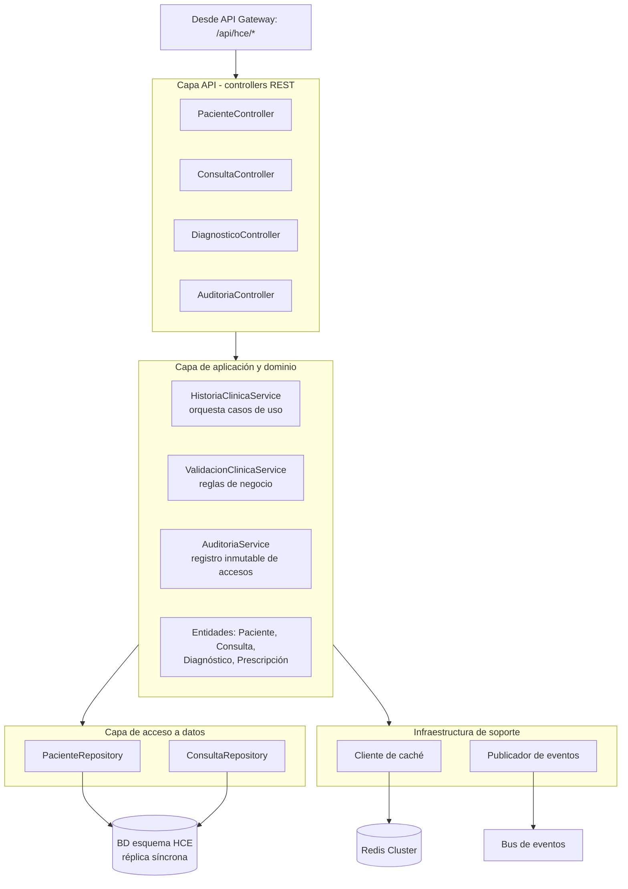

# Nivel 3 · Diagrama de componentes

> **Proyecto:** Sistema de Gestión Hospitalaria · **Contenedor detallado:** Servicio de Historia Clínica Electrónica (HCE)  
> **Modelo:** C4 · Nivel 3 de 4

---

## 1. Objetivo

Abrir el contenedor **Servicio HCE** del nivel 2 y mostrar sus **componentes**: las piezas internas, su responsabilidad y cómo se relacionan con la base de datos, la caché y el bus de eventos. Se detalla HCE por ser el módulo de mayor criticidad (ADR-008).

| Aspecto | Descripción |
|---|---|
| Pregunta que responde | ¿Cómo se divide por dentro el servicio y qué hace cada parte? |
| Audiencia | Arquitectos y desarrolladores |
| Qué es un componente | Un grupo de funcionalidades con una responsabilidad clara, accesible mediante una interfaz |
| Nivel anterior | [`Nivel2-DiagramadeContenedores.md`](Nivel2-DiagramadeContenedores.md) |
| Siguiente nivel | [`Nivel4-DiagramadeCodigo.md`](Nivel4-DiagramadeCodigo.md) |

---

## 2. Diagrama

---

## 3. Componentes

| Componente | Capa | Responsabilidad | Funcionalidades principales |
|---|---|---|---|
| `PacienteController` | API | Punto de entrada de pacientes | Consultar y crear la HCE (RF04) |
| `ConsultaController` | API | Punto de entrada de consultas | Registrar y consultar consultas (RF04, RF05) |
| `DiagnosticoController` | API | Punto de entrada de diagnósticos | Registrar diagnósticos y prescripciones |
| `AuditoriaController` | API | Consulta de auditoría | Listar accesos a una HCE (RF11) |
| `HistoriaClinicaService` | Aplicación | Orquesta los casos de uso | Coordina validación, persistencia, auditoría y eventos |
| `ValidacionClinicaService` | Aplicación / Dominio | Reglas de validación clínica | Valida consultas y diagnósticos antes de guardarlos |
| `AuditoriaService` | Aplicación | Trazabilidad | Registra de forma inmutable cada acceso y cambio (RF05, RF11) |
| Entidades | Dominio | Reglas del negocio | `Paciente`, `Consulta`, `Diagnóstico`, `Prescripción` |
| `PacienteRepository` | Acceso a datos | Persistencia de pacientes | Guardar y buscar pacientes |
| `ConsultaRepository` | Acceso a datos | Persistencia de consultas | Guardar y buscar consultas |
| Cliente de caché | Infraestructura | Acceso a Redis | Sesión clínica activa con TTL corto |
| Publicador de eventos | Infraestructura | Acceso al bus | Notifica a Laboratorio, Farmacia y Notificaciones |

---

## 4. Relaciones con contenedores y sistemas externos

| Componente | Destino | Descripción | Protocolo | Patrón aplicado |
|---|---|---|---|---|
| Repositorios | BD de HCE | Leen y escriben **solo** el esquema HCE | SQL | Repository |
| Cliente de caché | Redis | Guarda y lee la sesión clínica activa | TCP | Decorator |
| Publicador de eventos | Bus de eventos | Publica `ConsultaRegistrada`, `OrdenLaboratorioSolicitada` | Protocolo del bus | Publish/Subscribe |
| Adaptador de laboratorio | Laboratorio referencial | Envía órdenes y recibe resultados | HTTPS (HL7/FHIR) | Adapter |
| Llamadas salientes | Sistemas externos | Reintentos, timeouts y circuit breaker | — | Circuit Breaker |

---

## 5. Relaciones con otros servicios

| Origen | Destino | Descripción | Tipo de comunicación |
|---|---|---|---|
| API Gateway | Servicio HCE | Enruta `/api/hce/*` ya autenticado | HTTPS/JSON |
| Servicio Triaje | Servicio HCE | Consulta el historial del paciente | HTTPS/JSON (API de HCE) |
| Servicio HCE | Servicio Soporte | Publica eventos para notificar resultados disponibles | Evento asíncrono |

---

## 6. Reglas del enfoque

| # | Regla | Motivo |
|---|---|---|
| 1 | Cada capa solo invoca a la capa inmediatamente inferior | Cada capa evoluciona de forma independiente |
| 2 | Los controladores REST no contienen reglas de negocio | Las reglas clínicas se pueden añadir sin tocarlos |
| 3 | Un servicio solo lee y escribe **su propio esquema** | Independencia de datos entre servicios |
| 4 | Los demás servicios usan HCE solo mediante su API o sus eventos | Evita que un cambio interno rompa a otros |
| 5 | Cada sistema externo se integra en un único servicio | La integración queda en un solo lugar y es fácil de reemplazar |
| 6 | El motor de caché y el bus pueden sustituirse sin tocar el dominio | ADR-005, ADR-006 y ADR-008 |
| 7 | Reintentos, timeouts y circuit breakers se aplican en la capa de infraestructura | Sostienen la disponibilidad (AC01) |

---