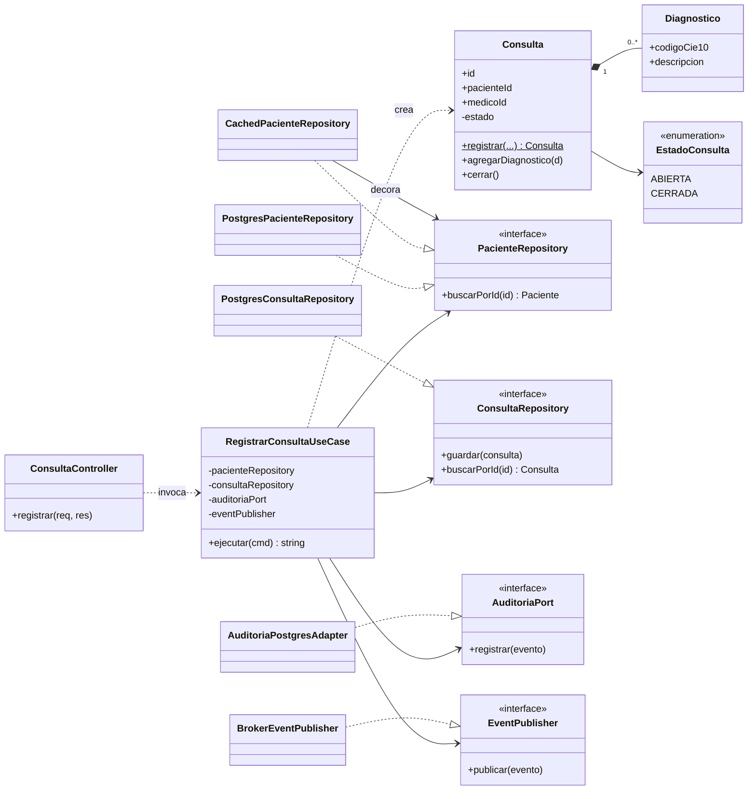
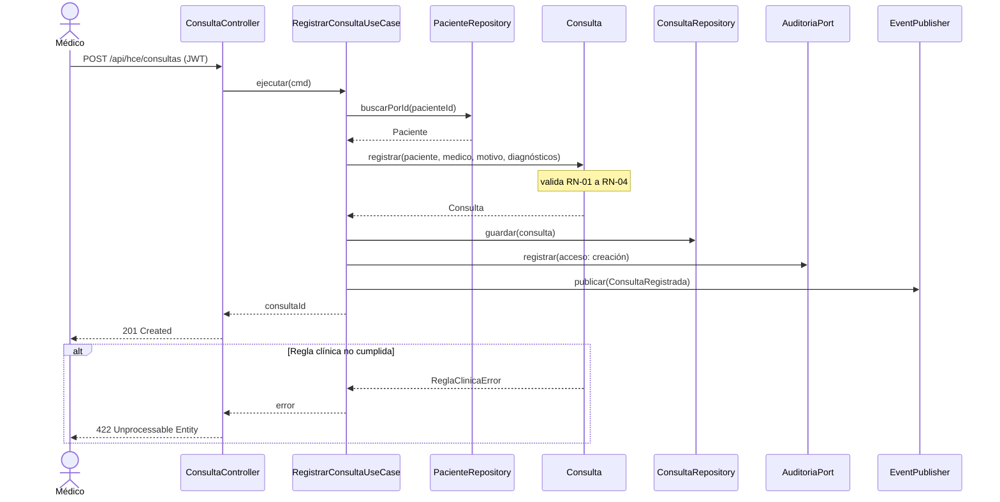

# Nivel 4 · Diagrama de código

> **Proyecto:** Sistema de Gestión Hospitalaria · **Servicio detallado:** Historia Clínica Electrónica (HCE)  
> **Modelo:** C4 · Nivel 4 de 4 · **Notación:** UML · **Flujo:** Registrar consulta

---

## 1. Objetivo

Mostrar **cómo está organizado el código** del servicio HCE: sus clases, interfaces y cómo colaboran. Se detalla el flujo **Registrar consulta**, que involucra validación clínica, persistencia, auditoría y publicación de eventos.

| Aspecto | Descripción |
|---|---|
| Pregunta que responde | ¿Qué clases existen dentro del servicio y cómo se relacionan? |
| Audiencia | Desarrolladores |
| Por qué solo HCE | El nivel 4 es opcional en C4 y se dibuja para los componentes más críticos o complejos |
| Nivel anterior | [`Nivel3-DiagramadeComponentes.md`](Nivel3-DiagramadeComponentes.md) |
| Detalle de capas y código | [`diseño-interno-de-modulos.md`](../03-diseño-de-software/diseño-interno/diseño-interno-de-modulos.md) |

---

## 2. Diagrama de clases

### 2.1 Capas

| Capa | Contiene | Regla |
|---|---|---|
| **Presentación (API)** | Controladores REST | Traduce HTTP a llamadas del caso de uso y viceversa |
| **Aplicación** | Casos de uso | Coordina los pasos; no conoce la tecnología |
| **Dominio** | Entidades, objetos de valor, interfaces (puertos) | Contiene las reglas del negocio; no importa nada de las otras capas |
| **Infraestructura** | Repositorios, caché, adaptadores, publicador | Implementa las interfaces del dominio con una tecnología concreta |

> **Regla de dependencia:** las flechas del código apuntan hacia el dominio. La infraestructura implementa interfaces del dominio; el dominio nunca conoce a la infraestructura.

### 2.2 Clases del servicio HCE

| Clase | Tipo | Capa | Responsabilidad |
|---|---|---|---|
| `ConsultaController` | Controlador | Presentación | Recibe `POST /api/hce/consultas` y responde al cliente |
| `RegistrarConsultaUseCase` | Caso de uso | Aplicación | Valida, guarda la consulta, audita y publica el evento |
| `Consulta` | Entidad | Dominio | Aplica las reglas de la consulta y controla su estado |
| `Diagnostico` | Objeto de valor | Dominio | Código CIE-10 y descripción |
| `EstadoConsulta` | Enumeración | Dominio | ABIERTA, CERRADA |
| `PacienteRepository` | Interfaz | Dominio | Contrato para buscar pacientes |
| `ConsultaRepository` | Interfaz | Dominio | Contrato para guardar y buscar consultas |
| `AuditoriaPort` | Interfaz | Dominio | Contrato para registrar accesos y cambios |
| `EventPublisher` | Interfaz | Dominio | Contrato para publicar eventos de dominio |
| `PostgresConsultaRepository`, `PostgresPacienteRepository` | Repositorio | Infraestructura | Implementan los contratos con la BD de HCE |
| `CachedPacienteRepository` | Decorator | Infraestructura | Lee primero de Redis y, si no está, de la BD |
| `AuditoriaPostgresAdapter` | Adaptador | Infraestructura | Guarda el registro de auditoría inmutable |
| `BrokerEventPublisher` | Adaptador | Infraestructura | Publica en el bus (Kafka o RabbitMQ, por definir) |

### 2.3 Notación UML

| Símbolo | Significado | Ejemplo |
|---|---|---|
| Línea continua con flecha | Asociación: la clase guarda una referencia | `RegistrarConsultaUseCase` → `ConsultaRepository` |
| Línea discontinua con flecha | Dependencia: la usa o la crea | `RegistrarConsultaUseCase` ..> `Consulta` |
| Línea discontinua con triángulo hueco | Realización: implementa una interfaz | `PostgresConsultaRepository` ..\|> `ConsultaRepository` |
| Rombo relleno | Composición | `Consulta` ◆ `Diagnostico` |
| `<<interface>>` | Interfaz | `AuditoriaPort` |

---

## 3. Diagrama de secuencia: registrar consulta

| Paso | Origen → destino | Acción |
|---|---|---|
| 1 | Médico → `ConsultaController` | `POST /api/hce/consultas`; el gateway ya validó el JWT y el rol |
| 2 | `ConsultaController` → `RegistrarConsultaUseCase` | Ejecuta el caso de uso |
| 3 | `RegistrarConsultaUseCase` → `PacienteRepository` | Obtiene al paciente (con caché) |
| 4 | `RegistrarConsultaUseCase` → `Consulta` | Crea la consulta y valida las reglas |
| 5 | `RegistrarConsultaUseCase` → `ConsultaRepository` | Guarda la consulta en la BD de HCE |
| 6 | `RegistrarConsultaUseCase` → `AuditoriaPort` | Registra el cambio de forma inmutable |
| 7 | `RegistrarConsultaUseCase` → `EventPublisher` | Publica `ConsultaRegistrada` para Laboratorio, Farmacia y Notificaciones |
| 8 | `ConsultaController` → Médico | Responde `201 Created` con el identificador |
| 9 | Alternativa | Si no se cumple una regla clínica, no se guarda nada y se responde `422` |

---

## 4. Patrones y principios que se ven en este nivel

| Elemento del diagrama | Patrón o principio |
|---|---|
| `AuditoriaPostgresAdapter`, `BrokerEventPublisher` | Patrón **Adapter** |
| `ConsultaRepository` y `PostgresConsultaRepository` | Patrón **Repository** |
| `CachedPacienteRepository` | Patrón **Decorator** |
| `EventPublisher` y el bus | **Publish/Subscribe** |
| El caso de uso recibe interfaces, no clases concretas | **Inversión de dependencias** (SOLID) |
| Una clase por responsabilidad | **Responsabilidad única** (SOLID) |

> Detalle en [`patrones-de-diseño.md`](..//03-diseño-de-software/diseño-interno/patrones-de-diseño.md) y [`principios-de-diseño.md`](../03-diseño-de-software/diseño-interno/principios-de-diseño.md).
